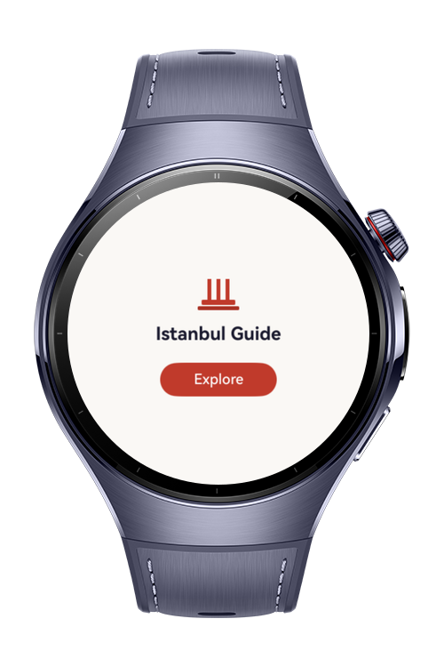
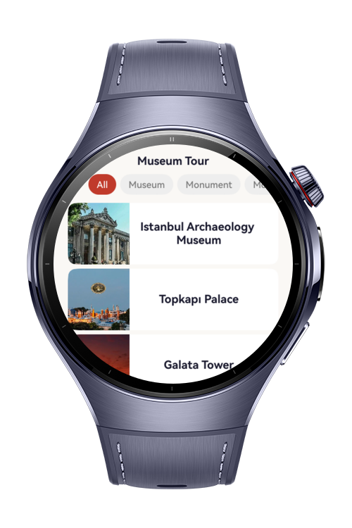

> **Note:** To access all shared projects, get information about environment setup, and view other guides, please visit [Explore-In-HMOS-Wearable Index](https://github.com/Explore-In-HMOS-Wearable/hmos-index).

# istanbul-travel-wearable

Istanbul Wearable is a HarmonyOS wearable cultural heritage guide app for Istanbul. Users can browse historical places by category, read detailed descriptions, listen to audio guides, and purchase tickets via QR code — all from their smartwatch.

# Preview
<div>

  
  
  
  

</div>

# Use Cases

Istanbul Wearable lets users:

* Browse cultural heritage places filtered by category (Museum, Monument, Mosque, Fortress, Palace).
* View detailed information including a hero image, full description, and place type badge.
* Listen to audio guides with play/pause and playback speed control (0.75x, 1x, 1.25x, 1.5x, 2x).
* Discover similar places within the same category.
* Purchase tickets by scanning an in-app QR code.

# Tech Stack

Languages: ArkTS  
Frameworks: HarmonyOS SDK 5.1.1(19)  
Tools: DevEco Studio  
Libraries: `@ohos.multimedia.media`, `@ohos.resourceManager`, `@ohos.util`

# Directory Structure

```
entry/src/main/ets/
|---components
|   |---PlaceItem.ets                 # Place list card component
|---entryability
|   |---EntryAbility.ets
|---entrybackupability
|   |---EntryBackupAbility.ets
|---model
|   |---AudioManager.ets             # AVPlayer management, playback state via AppStorage
|   |---PlaceData.ets                # Place class and PlaceDetailParam
|---pages
|   |---Index.ets                    # Home screen with Explore entry point
|   |---CategoryList.ets             # Category filter tabs + scrollable place list
|   |---PlaceDetail.ets              # Place info, audio guide, QR ticket, similar places
|---viewmodel
|   |---CategoryViewModel.ets        # Loads rawfile JSON data, category/tab filtering
```

## Data

Places are loaded from `entry/src/main/resources/rawfile/{index}.json` at runtime.  
Audio guides are loaded from `entry/src/main/resources/rawfile/mp3/{index}.mp3`.

Each place contains: `id`, `name`, `type`, `shortDescription`, `fullDescription`, `address`, `latitude`, `longitude`, `openCloseHours`, `image_url`, `officialWebsite`, `ticketPurchaseLink`, `contact`.

# Constraints and Restrictions

## Supported Devices
HarmonyOS 5.1.1(19) — Wearable

# LICENSE

Istanbul Wearable is distributed under the terms of the **MIT License**.  
See the [LICENSE](LICENSE) for more information.
